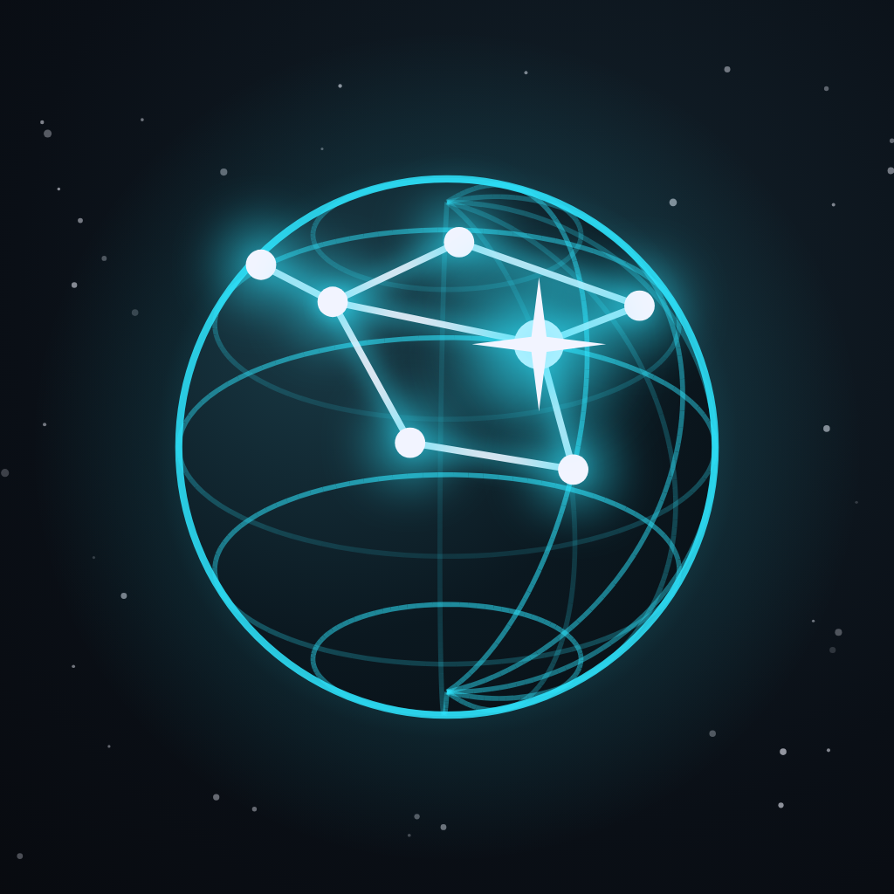

<p align="center">
  
</p>

<h1 align="center">Sary360</h1>

<p align="center">
  <b>Capture 360° spherical photos on your phone, fully offline.</b><br>
  Turn on the spot, complete the constellation, get a Photo Sphere.
</p>

<p align="center">
  <a href="https://flutter.dev"></a>
  <a href="https://dart.dev"></a>
  
  
</p>

---

## Overview

Sary360 is a Flutter app inspired by the "Photo Sphere" interaction of camera
apps, with its own **"Constellation"** visual identity: capturing a sphere
means completing a star map.

The user turns on the spot while the app shows target stars projected on the
camera preview. When a star is in the reticle and the phone is still, the
photo is taken automatically. A native C++ OpenCV module then stitches all
photos on the device into a 2:1 equirectangular image with Photo Sphere XMP
metadata, ready for Google Photos or the built-in immersive viewer.

### Features

- **Guided capture**: target stars on a sphere, fused device orientation
  (gyroscope + accelerometer), automatic shot after 300 ms of stillness,
  haptics, tilt and speed warnings, captured photos drawn on the sphere.
- **Ultra-wide support**: 26 shots with the ultra-wide lens (42 with the main
  lens).
- **On-device stitching** (C++ / OpenCV, FFI, isolate): sensor rotations as
  initial guess, neighbor-only matching, bundle adjustment, gyroscope drift
  compensation, sharp-photo seam priority, multi-band blending, progress and
  cancellation.
- **Floor eraser (on-device AI)**: rebuilds the area under the photographer's
  feet with MI-GAN, with a before/after preview and undo.
- **Gallery and immersive viewer**: slowly panning thumbnails, drag / pinch /
  gyroscope navigation, export to the phone gallery (Sary360 album).
- **100 % offline**: no backend, no account.

---

## Getting started

### Prerequisites

- Flutter **3.47.5** (pinned in `.fvmrc`, usable with [FVM](https://fvm.app))
- Android SDK with **NDK 28** and **CMake 3.22.1** (Android Studio → SDK
  Manager → SDK Tools)
- **OpenCV Android SDK 4.13.0** (native stitching module, ~320 MB, downloaded
  once)
- An Android device running Android 8.0+ (API 26+) with a gyroscope

### Setup

1. **Clone and fetch dependencies**
   ```bash
   git clone https://github.com/mandreshope/sary360.git
   cd sary360
   flutter pub get
   ```

2. **Install the OpenCV Android SDK** into `third_party/` (git-ignored)
   ```bash
   mkdir -p third_party && cd third_party
   curl -L -C - -o opencv-android-sdk.zip \
     https://github.com/opencv/opencv/releases/download/4.13.0/opencv-4.13.0-android-sdk.zip
   unzip -q opencv-android-sdk.zip && rm opencv-android-sdk.zip
   cd ..
   ```
   The SDK can live elsewhere: set its path in `android/local.properties`
   (`opencv.dir=/path/to/OpenCV-android-sdk`) or in the `OPENCV_ANDROID_SDK`
   environment variable.

3. **Run the app**
   ```bash
   flutter run              # debug
   flutter run --profile    # realistic stitching performance, logs kept
   ```
   Gradle builds the native module (`native/stitcher`) with CMake for
   arm64-v8a, armeabi-v7a and x86_64, linking OpenCV statically.

### Release builds

```bash
./scripts/build.sh                     # interactive
./scripts/build.sh android split n     # one APK per ABI
./scripts/build.sh android aab n       # Play Store bundle
```

Release signing reads `android/key.properties` (`storePassword`,
`keyPassword`, `keyAlias`, `storeFile=../key.jks`) and `android/key.jks`, both
git-ignored. Without them, the release is signed with the debug key.

---

## How it works

### 1. Guided capture

- An Android `EventChannel` streams the fused **GAME_ROTATION_VECTOR**
  orientation (gyroscope + accelerometer, no magnetometer, so no heading jumps
  near metal) as quaternions; other platforms fall back to raw sensors.
- Targets are rings of stars (horizon, ±45°, zenith, nadir). A target is "in
  the reticle" by angular distance, so the poles work like any other target.
- After 300 ms of stillness the photo is taken and the averaged quaternion is
  stored with it. Focus is locked after the first shot.
- Each capture writes a `session.json` manifest (measured quaternions, capture
  order), which lets developers replay a stitching exactly.

### 2. Stitching (C++ / OpenCV module)

Runs on the phone in a dedicated isolate, with progress and cancellation:

1. **Initial cameras**: rotation measured by the sensors for each photo, focal
   length derived from the field of view.
2. **ORB keypoints** and matching of **neighboring photos only**.
3. **Bundle adjustment** (`BundleAdjusterRay`) per group of connected photos,
   kept only if it reduces the matched-ray error; unrefined photos receive the
   correction of their neighbors in capture order (gyroscope drift).
4. **Focal self-calibration** and **seam priority to sharp photos**.
5. **Spherical projection**, exposure compensation
   (`BlocksGainCompensator`), graph-cut seams, multi-band blending.
6. **2:1 equirectangular image** (4096 × 2048), uncovered areas filled with a
   blurred gradient, Photo Sphere (GPano) XMP metadata.

### 3. Floor eraser (on-device AI)

From the viewer, the **Sol** button unfolds the floor around the nadir into a
top-down view and rebuilds a disc of the chosen radius with the **MI-GAN**
inpainting model (ICCV 2023, Picsart AI Research, MIT license), run by OpenCV
`dnn` in about 2 s. A before/after preview lets the user check the result
before applying, and the original image is kept so it can be restored.

### 4. Viewing and sharing

- Immersive viewer: drag to look around, pinch to zoom, optional gyroscope,
  recenter, info sheet.
- Export to the phone gallery (MediaStore / Photos) with the XMP metadata, so
  Google Photos can open the image as a 360° panorama.

---

## Architecture

```
lib/
├── core/            # theme, router, math (quaternions, projections), widgets
├── domain/          # models, capture session logic, interfaces
├── data/            # camera, orientation sources, stitching (FFI), repositories
└── presentation/    # pages, controllers (Riverpod), widgets
native/stitcher/     # C++ stitching module (OpenCV cv::detail + dnn)
android/.../OrientationStreamHandler.kt   # fused orientation EventChannel
```

- Layered architecture (presentation / domain / data), **Riverpod** for state,
  **go_router** for navigation.
- Heavy work runs off the UI thread: native stitching and AI inpainting in
  isolates; the ~50 Hz capture scene is driven by a `ValueNotifier` listened to
  directly by a `CustomPainter`.

### Native module

| Item | Location |
|------|----------|
| C interface (FFI) | `native/stitcher/include/sary_stitcher.h` |
| OpenCV pipeline | `native/stitcher/src/sary_stitcher.cpp` |
| CMake build | `native/stitcher/CMakeLists.txt` (called by `android/app/build.gradle.kts`) |
| Generated Dart bindings | `lib/data/native/sary_stitcher_bindings.g.dart` |
| Command-line test tool | `native/stitcher/tools/stitch_cli.cpp` (CMake option `-DSARY_BUILD_CLI=ON`) |

After changing the C header, regenerate the bindings (libclang required,
shipped with Xcode on macOS):

```bash
dart run ffigen --config ffigen.yaml
```

---

## Tech stack

| Area | Packages / tools |
|------|------------------|
| Framework | Flutter 3.47.5, Dart 3.10 |
| State & navigation | flutter_riverpod, go_router, shared_preferences |
| Camera & sensors | camera, Android rotation vector (EventChannel), sensors_plus (fallback) |
| Image processing | OpenCV 4.13 (C++, via dart:ffi + ffigen), MI-GAN (OpenCV dnn) |
| 360° viewer | flutter_cube (local fork of the panorama widget) |
| UI | google_fonts (Space Grotesk, Manrope), custom painters |
| Export | gal (gallery), Photo Sphere XMP |

---

## Development

```bash
flutter analyze      # must report "No issues found!"
flutter test         # unit and widget tests (runs on macOS)
```

The tests cover orientation math (quaternions, frame conversions), screen
projection, the capture session logic, settings persistence, onboarding and
viewer behavior.

Project conventions and tooling for contributors and AI assistants live in
[`CLAUDE.md`](CLAUDE.md) and `.claude/skills/` (on-device stitching tests,
FFI bindings, app icon, device diagnostics).

---

## Credits

- [OpenCV](https://opencv.org) — stitching pipeline and `dnn` runtime
  (Apache 2.0)
- [MI-GAN](https://github.com/Picsart-AI-Research/MI-GAN) — inpainting model,
  © 2024 Picsart AI Research (PAIR), MIT license; ONNX generator extracted by
  [FreeHugsForRobots/ps-inpaint-migan](https://huggingface.co/FreeHugsForRobots/ps-inpaint-migan)
- [flutter_cube](https://pub.dev/packages/flutter_cube) — 3D rendering of the
  360° viewer
- [gal](https://pub.dev/packages/gal), [camera](https://pub.dev/packages/camera),
  [sensors_plus](https://pub.dev/packages/sensors_plus) and the Flutter team

---

## Author

**Randrianarinjaka Mandresy** — [@mandreshope](https://github.com/mandreshope)
